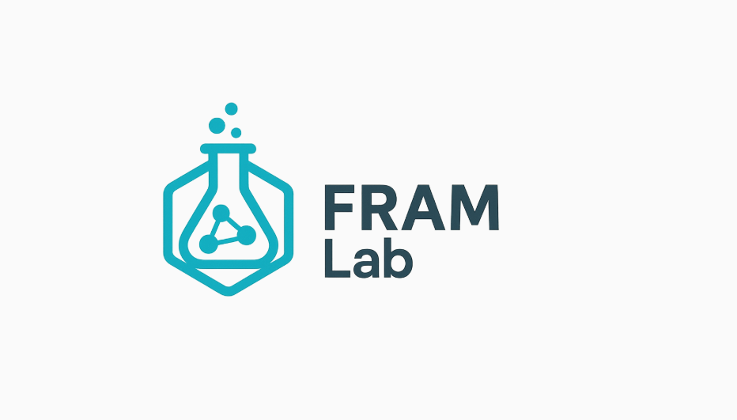

# FRAMLab

<p align="center">
  
</p>

A Blazor WebAssembly application for modelling and analysing socio-technical systems using the **Functional Resonance Analysis Method (FRAM)**. FRAMLab provides an interactive, browser-based environment to build, visualise, and simulate FRAM models.

## Features

- **Interactive FRAM Model Editor** — Create and edit functions, aspects, and couplings via an SVG-based visual canvas
- **XFMV File Support** — Import and export models in the `.xfmv` (FRAM Model Visualizer) format
- **Functional Model Instance (FMI)** — Define and run FMI simulations with variable definitions, run states, and diagnostics
- **Spreadsheet Views** — Tabular data views including Bayesian Belief Network (BBN) integration
- **Undo/Redo** — Full undo/redo support for model editing
- **Multi-language Support** — Localised UI (English, German, and more)
- **PDF Report Generation** — Export analysis results as PDF reports
- **Agent Levels** — Hierarchical agent-based modelling support

## Tech Stack

| Technology | Purpose |
|-----------|---------|
| [.NET 8](https://dotnet.microsoft.com/) | Runtime & SDK |
| [Blazor WebAssembly](https://dotnet.microsoft.com/apps/aspnet/web-apps/blazor) | Client-side .NET UI framework |
| [MudBlazor](https://mudblazor.com/) | Material Design UI component library |
| [Blazored.LocalStorage](https://github.com/Blazored/LocalStorage) | Browser localStorage integration |
| [QuickGrid](https://aspnet.github.io/quickgrids/) | Data grid component |
| SVG | Canvas rendering for model visualisation |
| [lodash](https://lodash.com/) | JavaScript utility library |

## Prerequisites

- [.NET 8 SDK](https://dotnet.microsoft.com/download/dotnet/8.0)

## Getting Started

1. **Clone the repository**

   ```bash
   git clone <repository-url>
   cd FRAMLab
   ```

2. **Restore dependencies and build**

   ```bash
   dotnet restore
   dotnet build
   ```

3. **Run the application**

   ```bash
   dotnet run
   ```

   The app will be available at `https://localhost:5001` (or the URL shown in the terminal).

## Project Structure

```
FRAMLab/
├── Pages/                  # Razor pages (main entry point)
├── Shared/
│   └── MainApp/
│       ├── Models/         # Domain models (Function, Coupling, Aspect, FMI types)
│       ├── Services/       # Business logic & interpreters
│       └── Views/          # Reusable UI components
│           ├── FMI/        # FMI simulation & spreadsheet views
│           └── FMV/        # FRAM Model Visualizer components
├── Localization/           # Multi-language resource files (.resx)
├── wwwroot/                # Static assets (CSS, JS, images, config)
├── TestFiles/              # Sample .xfmv files for testing
├── Program.cs              # Application entry point & DI setup
└── FRAMLab.csproj          # Project file
```

## Key Services

| Service | Description |
|---------|-------------|
| `FmiInterpreter` | Interprets and executes FMI model simulations |
| `FmiDefinitionService` | Manages FMI variable and type definitions |
| `FMIDisplayConfigService` | Configures the FMI display layout |
| `ExpressionEvaluator` | Evaluates expressions used in function definitions |
| `ProjectDocumentService` | Handles loading/saving of `.xfmv` project files |
| `AgentLevelService` | Manages agent-based modelling levels |
| `UndoService` | Tracks and applies undo/redo operations |
| `MetadataService` | Manages model metadata |

## File Format

FRAMLab works with `.xfmv` (FRAM Model Visualizer) XML files. Sample test files are included in the `TestFiles/` directory.

## License

This project is licensed under the **GNU Affero General Public License v3.0 (AGPL-3.0)**. See [LICENSE.md](LICENSE.md) for details.

