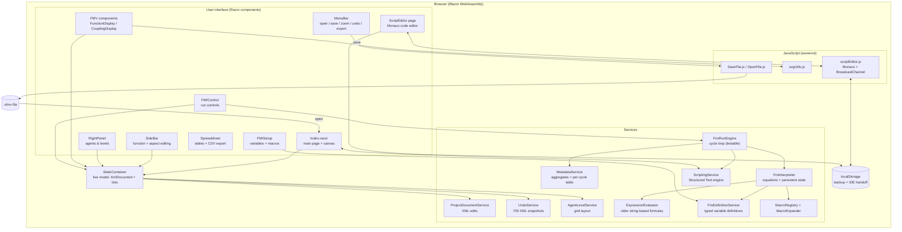
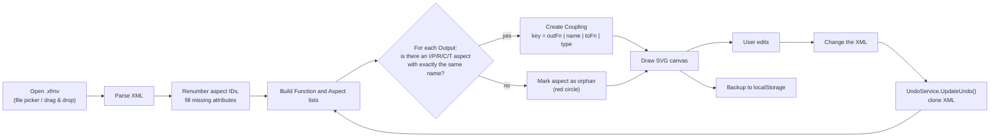
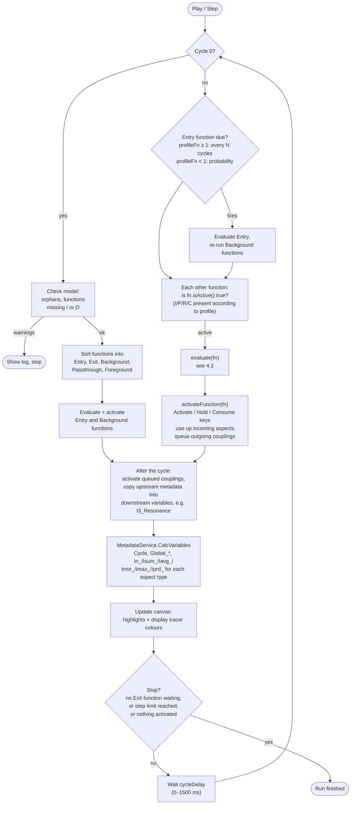
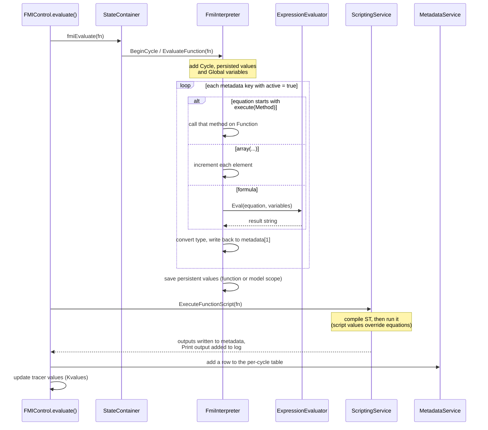
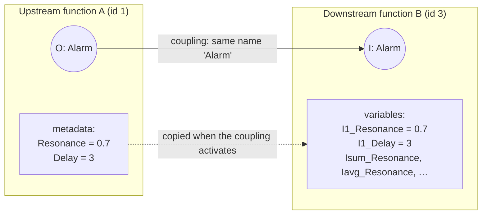
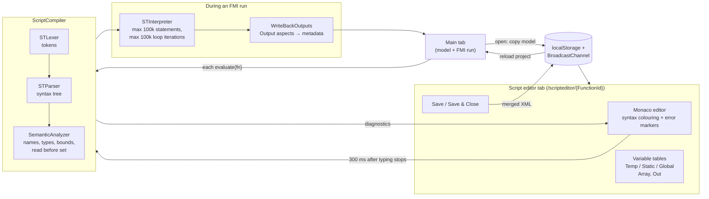
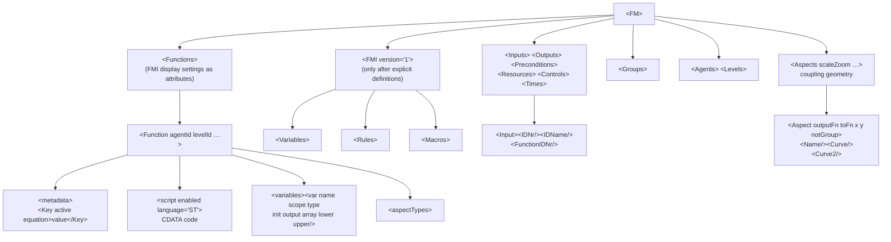

# FRAMLab: how it works and what it does

> This overview comes from reading the source code on branch `integration/fmi-modernization`, including the uncommitted arrays work. The app was not run to confirm it.
> Paths are relative to the repository root.

## Contents

1. [What FRAMLab is](#1-what-framlab-is)
2. [Architecture](#2-architecture)
3. [Loading and editing a model](#3-loading-and-editing-a-model)
4. [How a simulation (FMI) run works](#4-how-a-simulation-fmi-run-works)
5. [How scripts fit into a run](#5-how-scripts-fit-into-a-run)
6. [Feature list](#6-feature-list)
7. [The .xfmv file format](#7-the-xfmv-file-format)
8. [Build, deploy and tests](#8-build-deploy-and-tests)
9. [Gaps and likely bugs](#9-gaps-and-likely-bugs)

---

## 1. What FRAMLab is

FRAMLab is a browser app for building and simulating models with the **Functional Resonance Analysis Method (FRAM)**.

- **Platform:** it runs entirely in the browser (Blazor WebAssembly on .NET 8). There is no server: files are opened from the user's computer and saved as downloads.
- **Interface:** MudBlazor for the controls, QuickGrid for tables, and SVG for drawing the model.
- **Model:** a FRAM model is a set of **functions**. Each function has up to six **aspects**:

| Letter | Aspect |
|---|---|
| O | Output |
| I | Input |
| P | Precondition |
| R | Resource |
| C | Control |
| T | Time |

- **Couplings:** a coupling links one function's Output to another function's I, P, R, C or T aspect.

---

## 2. Architecture

**How the model is stored.** The open `.xfmv` file stays in memory as an `XmlDocument`.

1. Every edit changes that XML, through `ProjectDocumentService` or directly in the components.
2. `Index.razor` → `FileIsLoaded()` then rebuilds all the in-memory lists (functions, aspects, couplings) from the XML.
3. Undo stores whole copies of the XML. Undoing or redoing restores a copy and runs the same rebuild.

**How the pieces are wired.** All services are registered in [`Program.cs`](../Program.cs). `ScriptingService` is connected to `StateContainer` after startup; registering it directly would create a circular dependency.

---

## 3. Loading and editing a model

**How couplings are found.** Two aspects are coupled when an **Output's name exactly matches** the name of an Input, Precondition, Resource, Control or Time aspect on another function. The match is case-sensitive.

**How couplings are drawn.** Each coupling is two quadratic Bézier curves. Their control points depend on the target aspect type.

---

## 4. How a simulation (FMI) run works

FMI stands for FRAM Model Instantiation.

**Data on each function**
- **Metadata rows:** `[name, value, active, equation, initial]`.
- **Profile:** All, Any or None for each of I, P, R and C. It sets which incoming aspects must be present before the function activates.

**Where the code is.** The run loop is in [`FmiRunEngine.cs`](../Shared/MainApp/Services/FmiRunEngine.cs). [`FMIControl.razor`](../Shared/MainApp/Views/FMI/FMIControl.razor) only drives it.

### 4.1 One run

### 4.2 Evaluating one function

### 4.3 How values move from one function to the next

---

## 5. How scripts fit into a run

Each function can have a script in a Structured Text dialect.

**Variables a script can see.** Name lookup goes in this order: **Temp → Static → Global → aspect variables**.

| Kind | Lifetime / access |
|---|---|
| Temp | Reset every cycle |
| Static | Kept for each function for the whole run |
| Global | Shared by all functions |
| Aspect variables | Created from the function's aspects, e.g. "Hazard signal" becomes `Hazard_signal`. I/P/R/C/T are read-only; O can be written. |

---

## 6. Feature list

### 6.1 Model editor

**Files and export**
- **Open** `.xfmv` files (about 1 MB maximum) by file picker or by dropping onto the empty canvas.
- **Save** downloads the `.xfmv`. Simulation values are reset to their initial values first.
- **Import and export a selection** as `.sxfmv`. On import, IDs are reassigned, positions are offset by 40 px, and agents/levels with the same name are merged.
- **Export the canvas** as SVG.
- **Report (HTML):** a table of functions (orphans highlighted), downloaded as HTML together with the SVG.

**Functions and aspects**
- **New function** with "+". The first one creates an empty model; there is no separate New command.
- **Name and description fields.** Clearing the name deletes the function, but only if it has no aspects.
- **Aspect buttons O/I/P/R/C/T.** Typing an aspect name autocompletes from existing names of the same type. Clearing the text deletes the aspect.
- **Orphans:** aspects with no matching partner get a red circle.
- **Function type** is set automatically. A function with no P/R/C/T that also lacks an Input or an Output becomes Background; all others are Foreground.

**Canvas**
- **Selection:** click, Ctrl/Cmd-click to add, or drag a box.
- **Dragging** works with mouse or touch and moves all selected functions. The canvas grows near its edge.
- **Coupling labels** can be selected and dragged along their curve.
- **Zoom** from 0.25× to 4×, or fit to screen. Separate controls set the size of function text and coupling labels.
- **Groups:** one function is the parent of the others. Double-click the parent to collapse or expand the group.
- **`Hyperlink` metadata key:** turns a function's text into a link.

**Appearance**
- **Six drawing styles** from [`renderoptions.json`](../wwwroot/renderoptions.json): Traditional, Modern, Floating, Autonomy, Iconic and 2024.
- **Custom colours** from a palette dialog, with text colour picked automatically for contrast.
- **Aspect labels** can be shown or hidden.

**Agents and levels**
- **Created** in the right panel, each with a colour.
- **Assigned** to functions in the sidebar.
- **Agents & Levels view:** the only automatic layout. Levels are rows and agents are columns. Turning the view off restores the earlier positions.

**Tables**
- **Split or full-screen table** of function properties, aspects, FMI profile and metadata, plus a table of values for each cycle.
- **CSV export** for functions, couplings and metadata.

**Undo and redo**
- **Undo/Redo** keeps up to 700 full copies of the XML. Shortcuts: Ctrl/Cmd+Z, and Ctrl/Cmd+Y or Ctrl/Cmd+Shift+Z.

**Keyboard shortcuts** (only when the canvas has focus)

| Key | Action |
|---|---|
| ← / → | Previous / next function |
| I O P R C T | Jump to that aspect's input field |
| `+` | Focus the new-function button |
| Ctrl/Cmd + D | Duplicate the selection |
| Ctrl/Cmd + Z | Undo |
| Ctrl/Cmd + Y, Ctrl/Cmd + Shift + Z | Redo |
| Delete | Delete the selection |

**Other**
- **Backup:** the model is saved to localStorage after every change. It is restored only when you press the Reload button.
- **Languages:** English and German, following the browser's language.

### 6.2 FMI simulation

**Running**
- **Controls:** Reset, Step, Play/Stop, a speed slider (0–1500 ms per cycle) and an optional maximum number of steps.
- **Function roles:** Entry, Exit, Background, Passthrough and Foreground.
- **Entry timing:** fire every N cycles, or with a probability if the setting is below 1.
- **Activation profiles:** All (∀), Any (∃) or None (∅) for I/P/R/C.
- **Control keys:** `Activate` (block the function, or filter which couplings it uses), `Hold` (keep named inputs), `Consume` (force inputs to be used up), `Variable`.

**Values**
- **Automatic totals** for each aspect type: `In_`, `Isum_`, `Iavg_`, `Imin_`, `Imax_`, `Iprd_`, plus `Cycle` and `Global_*`.
- **Expression language** ([`ExpressionEvaluator.cs`](../Shared/MainApp/Services/ExpressionEvaluator.cs)):
  - operators `+ - * / ^`, `π`, comparisons, `&&`, `||`, XOR and `?:`;
  - `min`, `max`, `round`, `sqrt`, `sin`/`cos`/`tan` (in degrees), `abs`, `exp`, `log`, `ceiling`, `floor`, `int`;
  - random numbers: `rnd`, `rndi`, `rnorm`, `rnormi`;
  - `lookup` and `xref`, which read from an imported CSV;
  - `execute(Method)`.
- **Newer typed engine:**
  - types number, boolean, string, `array<T>`, list and dictionary;
  - variable scopes Cycle, Function, Model, Input and Output;
  - values that carry over between cycles;
  - a snapshot of every cycle;
  - variables inferred from older files that don't declare them;
  - typed problem reports (errors, warnings, info).
- **Macros:** named formulas for one function or the whole model. Arguments are type-checked, nesting stops at 10 levels, and macros that call each other in a loop are detected.

**Display and tools**
- **Display tracers:** up to 6 metadata values coloured live on the canvas, each with 5 thresholds and 3 colours, in Blend or Ratio mode.
- **Mode presets:** Basic, BBN, LOPA and NEURON.
- **Log window:** can be saved as `*-fmilog.txt`.
- **Variable panel:** lists the selected function's variables.

### 6.3 Structured Text scripting

**Language**
- **Control flow:** IF/ELSIF/ELSE, FOR…BY, WHILE, REPEAT…UNTIL, EXIT, RETURN.
- **Types:** BOOL, INT, REAL, STRING and TIME (written `T#5s`).
- **Operators:** AND, OR, XOR, NOT, MOD.
- **Comments:** `(* *)` and `//`.
- **Arrays** (uncommitted work): one-dimensional, `a[i]`, `[1,2,3]` literals, whole-array copy, bounds checks, at most 100k elements.

**Built-in functions**
- **Model access:** `GetInput`, `GetPrecondition`, `GetResource`, `GetControl`, `GetTime`, `SetOutput`, `Cycle`, `IsActive`.
- **Output:** `Print`, `Trace`.
- **Maths:** ABS, SQRT, SIN, COS, TAN, LN, EXP, MIN, MAX, LIMIT, ROUND, TRUNC.

**Checks and limits**
- **Before running:** undeclared names, writes to read-only variables, wrong argument counts, constant indexes out of bounds, values read before they are set, and type-mismatch warnings.
- **Limits:** a script stops after 100k statements, and a loop stops after 100k iterations.

**Script editor page**
- **Code editor:** Monaco with syntax colouring and error markers.
- **Problems panel:** clicking an entry jumps to that line.
- **Variable tables:** aspect types plus Local and Global variables.
- **Controls:** an Enabled toggle, Save and Save & Close.
- **Fallback:** a plain text box if Monaco fails to load.

---

## 7. The .xfmv file format

**Compatibility rules**
- **Untouched older files** save back unchanged: the `<FMI>` and `<Macros>` nodes are created only when they are first needed.
- **Aspects in scripts** are rebuilt from the couplings when a file loads. Only their types are stored.

---

## 8. Build, deploy and tests

**Build and deploy**
- **CI** ([`ci.yml`](../.github/workflows/ci.yml)): builds and runs the tests on pushes to `main` and `integration/fmi-modernization`, and on pull requests to `main`.
- **Deploy** ([`deploy.yml`](../.github/workflows/deploy.yml)): publishes to GitHub Pages, rewriting `<base href>` for the repository path.

**Tests** ([`FRAMLab.Tests`](../FRAMLab.Tests/), xUnit)

The test project compiles the engine source files directly, because a WebAssembly project can't be referenced from a test project.

| Area | Covered |
|---|---|
| FMI values and types | Round-trips, type inference, failed conversions, nested types |
| Variable definitions and merging | XML round-trip, scopes, warnings, priority rules |
| Macros | Scope visibility, loop detection, type checks, nesting limit |
| Values kept across cycles | Accumulating values, reset, snapshots |
| Known-output comparison | 3 cycles of `FMV_FeatureTest.xfmv` |
| Scripting | Lexer, precedence, control flow, scopes, aspect binding, XML round-trip |
| Arrays (new) | Parsing, bounds, writes, persistence, example file |
| Simulation with scripts (new) | Multi-cycle run of `FMV_Scripting_Full_Feature.xfmv` |
| **Not tested** | Editor and interface, the FMIControl run loop, ExpressionEvaluator on its own, REPEAT/EXIT/TIME |

---

## 9. Gaps and known limitations

### 9.1 Fixed (2026-10-29)

| Area | What was wrong | Fix |
|---|---|---|
| FMI | Macros were never used in a simulation | `EvaluateFunction` now calls `EvaluateExpression`, which still uses the old evaluator when a model has no macros. Macro built-ins now match the old evaluator: trig in degrees, `round(x, digits)`, `rnd`/`rndi(from, to)`. |
| FMI | `Execute(...)` from the BBN/LOPA presets was not recognised and produced NaN | `execute(` is matched case-insensitively. An unknown method leaves the value unchanged and reports a warning. |
| FMI | Problem reports from the newer engine only went to the browser console | They now appear in the FMI log as well, with definition-load problems at the start of each run. |
| FMI | Nested `?:` expressions broke | Each `?` is now matched to its own `:`, taking nesting, parentheses and strings into account. The branch not taken is skipped. |
| Script | EXIT inside WHILE/REPEAT ended the whole script | EXIT now leaves only the innermost loop. |
| Script | Lowercase built-ins (`print`) gave a wrong argument-count error | Built-in names are case-insensitive at compile time and at runtime. |
| Script | `T#…` time literals could not be used in code, and TIME variables ignored their initial value | The lexer recognises `T#`/`TIME#` before identifiers, and initial values are parsed. |
| Script | Script outputs overwrote the metadata initial value | Only the current value is updated, so Reset and Save restore the original. |
| Script | Globals made in the editor's Global table were never saved | Stored as `<FM><ScriptGlobals>` in the `.xfmv` and loaded by both tabs. |
| Script | Unclear "Unexpected token" errors for `CASE` and `VAR` | Specific messages now explain what to use instead. Editor highlighting lists only supported words. |
| Editor | Adding or renaming an aspect couldn't be undone, and there was no Ctrl+Z | Both are now recorded. Ctrl/Cmd+Z and Ctrl/Cmd+Y were added. |
| Editor | Loading could link a function to itself | Loading now skips a function's own aspects, as editing already did. |
| Editor | Saving with Agents & Levels open saved the grid layout | Save and the local backup write the user's own positions. |
| App | The About page promised offline use, and the "PDF report" was HTML | The text was corrected and the menu item is now "Report (HTML)". |

### 9.2 Added (2026-10-29, second round)

| Area | Change |
|---|---|
| FMI | **Run loop moved** into `FmiRunEngine` (plain C#, tested without the UI). `FMIControl` only drives it. |
| FMI | **Unknown variables stop the run.** An equation that uses a variable nothing defines keeps its previous value, and a dialog asks: add it as a key, read it as 0 (until reload), or edit the equation. Values that simply haven't arrived yet (`I3_Key`, `Isum_Key`, `Global_*`, `Prev_*`, own keys, typed variables, script outputs) still read as 0. |
| FMI | **FMI Setup dialog** with Overview (what the model uses, evaluation order), Variables (typed variables) and Macros (formula macros only). |
| FMI | **Model loading fix:** opening a file now loads its `<FMI>` section. Before, typed variables and macros in a file were ignored until one was edited. |
| FMI | **Run log** is a filterable list (level, source), and clicking a function selects it. Plain text is still available and still saved. |
| FMI | **`Prev_*` switch** in the FMI panel. **BBN, LOPA and NEURON** are hidden until they have calculations. `api()` stays as a placeholder. |
| Display | **ST and ƒ badges** on functions with a script or a macro call. An always-visible summary (ST / ƒ / Var) opens FMI Setup. |
| Script | **Arrays have no bounds:** they start at 0, grow when written, and are limited to 100,000 elements. Reading an element that was never written is an error. Whole-array assignment replaces the contents. Older lower/upper bounds still place the initial value. |
| App | **Dialogs close from their buttons.** Close buttons, Enter and clicking outside only worked through Escape or the X before. |
| Tests | Run engine, expression evaluator, unknown variables, arrays and usage summary: 222 tests in total. |

### 9.3 Added (2026-10-29, third round)

| Area | Change |
|---|---|
| FMI | **Rule macros removed.** Macros are formulas only. Files with `kind="rule"` load with a clear error for that macro, and the empty `<Rules>` placeholder is no longer created. |
| Script | **CASE** with single labels, lists (`2, 3`), ranges (`4..9`), negative labels and ELSE. Overlapping labels are compile errors. |
| Script | **2-D arrays** (`m[row, col]`), chosen next to the Array checkbox. They grow in both directions and stay rectangular, gaps are 0, reading an unwritten cell is an error, and there's a 100,000-cell limit. Literals are `[[1, 2], [3, 4]]`, and starting values `1,2;3,4`. |
| Script | **Autocomplete** for variables, aspects, built-ins (with parameter placeholders), keywords and IF/FOR/WHILE/REPEAT/CASE snippets. It is built from the compiler's symbol table, so suggestions match what compiles. |
| Script | **Run one cycle** panel in the script editor: inputs prefilled from upstream values, Static/Global starting values, and results (outputs, Print, errors). Nothing is written back to the model. |
| FMI | **Live data with `api("source", "path")`** in equations and macros, and `API('source', 'path')` in scripts. See 9.4. |
| App | The editor's suggestion box was unreadable because the page's `.main` styles also matched Monaco; those styles are now limited to `#mainWindow`. The lodash library loaded from a CDN was replaced by a local function. |

### 9.4 Live data (`api()`)

- **Sources** are defined in FMI Setup → Data sources and stored in `<FMI><DataSources>`. Two kinds:
  - **HTTP:** a URL, a REST API, or a REST layer in front of a database, returning JSON or CSV.
  - **WebSocket:** a streaming feed; the latest message is the value.
- **Browser only:** sources must allow CORS. There is no companion server.
- **Read only:** a run never changes anything outside FRAMLab.
- **Keys:** an optional key header names where the API key goes. The key itself stays in the browser's localStorage and is never written to the `.xfmv`.
- **Timing per function and source** is stored in `<FMI><DataUses>`:
  - **On activation:** fetched just before the function's equations run.
  - **Live:** the source's latest value at the moment of the read (WebSocket messages, or HTTP refreshed in the background).
  - **On exit:** fetched after the function activated; its next evaluation reads that data.
- **Paths** look like `current.temperature_2m`, `hourly.time[3]`, or for CSV `2.Temperature` (row, column header).
- **Failures:** an unavailable value pauses the run in the unknown-variables dialog, with the reason (for example HTTP 404, a CORS block, or a path that wasn't found). Scripts report it as a runtime error.
- **Example:** `TestFiles/FMV_LiveData_Weather.xfmv` reads Open-Meteo (Berlin, no key) using all three timings and a macro.

### 9.5 Still open

| Area | Item |
|---|---|
| FMI | BBN, LOPA and NEURON calculations (hidden; future work). |
| FMI | MQTT over WebSocket would need an MQTT client library; plain WebSocket feeds with JSON messages work today. |
| App | Offline/PWA support and translations (postponed). |
| Editor | Zoom is not part of undo, by design: it is a view setting, not a model change. |
